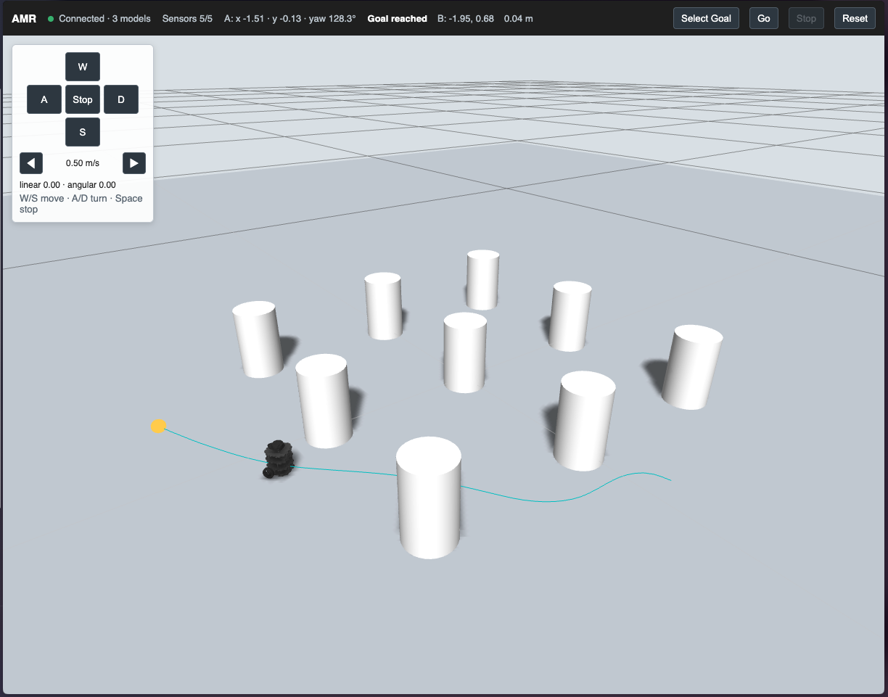

# AMR Navigation Simulator

Gazebo-based AMR simulator with a FastAPI control server, Dijkstra global
planning, and DWA-lite local planning.



## Run with Docker

Requirements: Docker and Docker Compose. No local Gazebo or `uv` installation
is needed.

```bash
docker compose up --build
```

Open <http://localhost:8009>.

Stop the simulator:

```bash
docker compose down
```

Useful commands:

```bash
docker logs -f amr-app
docker compose exec amr bash
```

## Tests

Run the normal test suite:

```bash
docker compose run --rm amr uv run python -m unittest discover -s src/tests -p 'test_*.py'
```

Run the 12-case Gazebo navigation smoke test:

```bash
RUN_GZ_SIM_SMOKE=1 docker compose run --rm amr uv run python -m unittest src/tests/test_amr_navigation_sim_smoke.py
```

## Controls

- `W` / `S`: forward / backward
- `A` / `D`: turn left / right
- `Space`: stop
- Select a goal on the map, then press `Go` for autonomous navigation.

The service uses image `amr-app:latest` and container `amr-app`.
