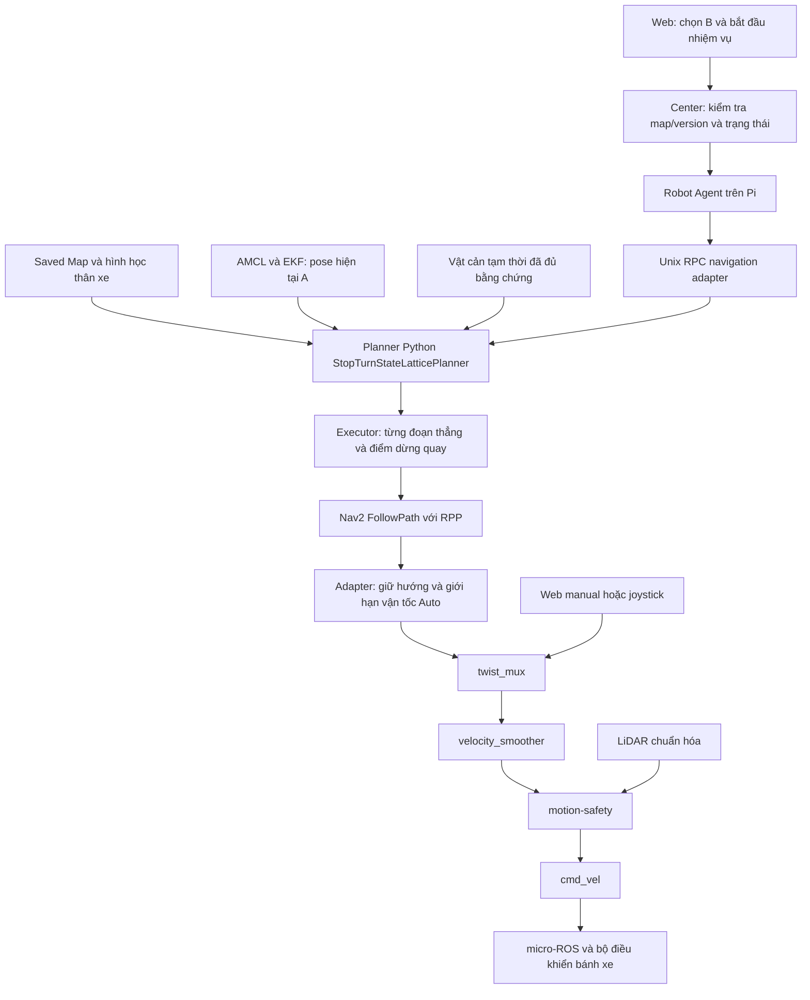

# Trả lời về cảm biến, tạo bản đồ và tự hành A → B

**Ngày kiểm tra: 07/09/2026.** Đã đọc mã tại `/home/mqs/Desktop/Robot_dulich/` và SSH vào `pi@192.168.6.170`, kiểm tra mã tại `/home/pi/Desktop/demo/robot-simulator/`, thiết bị Linux, ROS graph, dữ liệu topic và trạng thái adapter. Mẫu cảm biến mới được lấy khoảng **11:03:34–11:03:44, giờ Việt Nam**. Đối chiếu SHA-256 của 12 file chính trên Pi với máy trung tâm: đều giống nhau.

**Ba câu trả lời chính:**

1. Ngoài LiDAR, đang có dữ liệu **IMU, odometry từ bộ điều khiển xe và pin**, đồng thời Pi nhận **một camera USB**. IMU có dữ liệu nhưng chưa được fuse vào định vị EKF; camera dùng cho quan sát/video, chưa dùng cho tránh vật cản. Bumper, chống rơi và cảm biến khoảng cách phụ mới có đầu vào phần mềm, chưa thấy nguồn dữ liệu thực hoạt động.
2. **Đã có module tạo bản đồ 2D ban đầu bằng SLAM Toolbox**, có giao diện thao tác, lưu bản đồ, lưu pose graph, tiếp tục mapping và đồng bộ bản đồ về trung tâm. Trên Pi có các bộ bản đồ đã tạo thực tế, gồm v1 đến v5. Hiện robot ở chế độ NAVIGATION nên SLAM Toolbox không chạy trong ROS graph tại thời điểm kiểm tra.
3. **Đã triển khai luồng A → B trên ROS 2 Humble + Nav2, kết hợp planner/executor và motion-safety tự viết.** Có tính đường, bám từng đoạn, dừng trước vật cản, theo dõi vật cản, chờ đường thông, tìm đường vòng và phục hồi. Tuy nhiên, còn lỗi dữ liệu và chuyển trạng thái đã xác minh; chưa thể gọi là đã nghiệm thu tự hành mượt, tự tránh và luôn tới đích trong mọi tình huống có đường.

Lần này chỉ đọc và quan sát; không chạy một nhiệm vụ A → B, không bật phiên mapping, không phát lệnh motor hoặc thay đổi cấu hình robot.

---

## 1. Robot hiện có những sensor nào ngoài LiDAR?

### 1.1. Những nguồn dữ liệu và thiết bị đã xác nhận

| Thành phần | Bằng chứng trên robot | Đang dùng vào việc gì? | Giới hạn xác nhận |
| --- | --- | --- | --- |
| **IMU: gia tốc kế và con quay hồi chuyển** | `/imu`, kiểu `sensor_msgs/Imu`, publisher `YB_Car_Node`; nhận 157 mẫu trong khoảng 10 s, khoảng 15.71 Hz. Có các trường gia tốc x/y/z và vận tốc góc x/y/z. | Qua `sensor_normalizer` thành `/imu/normalized`, phục vụ chẩn đoán và chuẩn bị hiệu chuẩn. | Chưa xác nhận mã chip hay số trục phần cứng. Orientation đang là quaternion đơn vị, gyro z bằng 0 trong mẫu đứng yên; chưa được chứng minh dùng tốt để đo yaw khi quay. |
| **Odometry của xe/bánh xe** | `/odom_raw`, kiểu `nav_msgs/Odometry`, publisher `YB_Car_Node`; khoảng 11.10 Hz. Frame đầu vào `odom_frame`, child `base_footprint`. | Chuẩn hóa thành `/odometry/normalized`; EKF dùng vận tốc tiến và vận tốc quay để ước lượng chuyển động. Executor và safety dùng vận tốc phản hồi. | Odometry là kết quả ước lượng, không phải một cảm biến riêng. Mã coi đây là wheel odometry từ bộ điều khiển xe; phiên kiểm tra chưa xác minh số encoder, độ phân giải xung hoặc firmware tích phân từng bánh. `/joint_states` không có publisher. |
| **Nguồn đo/telemetry pin từ bộ điều khiển** | `/battery`, kiểu `std_msgs/UInt16`, publisher `YB_Car_Node`; 10 mẫu, khoảng 1 Hz; mẫu cuối `data=81`. | Hiện có trên ROS, có thể dùng để theo dõi nguồn điện. | Message không khai báo đơn vị; chưa đủ bằng chứng kết luận 81 là 81% hay điện áp đã nhân hệ số. Cần đối chiếu firmware/đồng hồ đo. |
| **Camera USB 2D** | USB ID `05a3:9230`; Linux nhận `USB 2.0 Camera: HD USB Camera`, `/dev/video0` và `/dev/video1`, cùng một thiết bị USB. | Mã media có capture camera và truyền video qua LiveKit/WebRTC để người vận hành quan sát/điều khiển. | Hai video node không có nghĩa là hai camera. Chưa xác nhận camera chiều sâu/stereo. Không có luồng thị giác đưa ảnh vào planner/costmap/safety trong stack đang đọc. |

Để đối chiếu, LiDAR đang phát `/scan` khoảng **12.63 Hz**, 360 tia, message khai báo khoảng đo 0.12–8 m. Đây là phạm vi trong message, chưa phải kiểm chứng độ chính xác cảm biến ở mọi khoảng cách.

### 1.2. IMU có, nhưng chưa thực sự tham gia EKF điều hướng

Trong `navigation-stack/config/ekf.yaml`, EKF chỉ lấy từ `/odometry/normalized`:

- `vx`: vận tốc tiến theo thân xe.
- `wz`: vận tốc quay quanh trục đứng.

Không có cấu hình fuse `imu0` vào EKF. Mã `sensor_normalizer.py` còn đặt `orientation_covariance[0] = -1`, tức đánh dấu orientation IMU không sử dụng được. Vì vậy, mô tả chính xác là **robot có luồng IMU, nhưng định vị hiện dựa vào wheel odometry + LiDAR/AMCL; không nên mô tả là đã hợp nhất LiDAR + encoder + IMU hoàn chỉnh**.

Mẫu mới có gia tốc z khoảng 9.828 m/s², gyro x/y khác zero nhỏ, chứng minh topic có dữ liệu số. Việc gyro z bằng 0 khi đứng yên chưa đủ để kết luận cảm biến hỏng hoặc đúng khi robot quay; cần test trục, dấu và tỷ lệ góc bằng chuyển động có kiểm soát.

### 1.3. Các sensor chưa xác nhận đang hoạt động

| Thành phần | Quan sát mới | Kết luận phù hợp |
| --- | --- | --- |
| Bumper/cảm biến va chạm | `/safety/bumper` có kiểu topic do subscriber đăng ký, **0 publisher, 0 mẫu**. | Có đầu vào phần mềm, chưa có bằng chứng cảm biến đang nối và hoạt động. |
| Chống rơi/mép cầu thang | `/safety/cliff`: **0 publisher, 0 mẫu**. | Chưa có chức năng chống rơi được chứng minh bằng cảm biến thật. |
| Siêu âm/ToF/range phụ | `/safety/range`: **0 publisher, 0 mẫu**. | Có hỗ trợ `sensor_msgs/Range`, chưa chứng minh đã lắp hoặc tích hợp nguồn đo. |
| Microphone | ALSA chỉ thấy HDMI; PipeWire chỉ có `auto_null.monitor`, không thấy nguồn microphone vật lý. | Mã hỗ trợ audio, nhưng thời điểm kiểm tra chưa thấy microphone khả dụng. `monitor` của dummy sink không phải mic. |
| Camera depth, GPS, từ kế riêng | Không thấy nguồn topic tương ứng trong ROS graph được quan sát. | Chưa có bằng chứng sử dụng trong stack hiện tại; không suy ra chắc chắn toàn bộ phần cứng đều không có. |

Trong `motion-safety/config/safety.yaml`, heartbeat của cliff/bumper/range đều chưa bắt buộc. `/safety/estop` có dữ liệu khoảng 2 Hz từ `rovera_control_bridge`; đó là **E-stop phần mềm/heartbeat điều khiển**, chưa phải bằng chứng có nút E-stop phần cứng độc lập.

Joystick USB DragonRise và hai topic servo cũng không phải sensor phục vụ nhận biết môi trường: joystick là thiết bị nhập lệnh, servo là cơ cấu chấp hành.

### 1.4. Lưu ý về số pin trên giao diện trung tâm

Đã thấy pin thật trên ROS, nhưng `simulator/client.py`, hàm `_telemetry_loop()`, hiện vẫn gửi:

```python
"battery_percent": 78
```

Đoạn này không lấy giá trị từ `/battery`; ngoài ra RTT và packet loss trong cùng payload cũng đang được tạo ngẫu nhiên. Vì vậy **không dùng số pin 78% trên trung tâm làm bằng chứng đọc được sensor pin thật**. Cổng preflight `BATTERY_LOW` phía trung tâm lại kiểm tra `battery_percent >= 15`, nên cần nối telemetry thật và xác định đơn vị/chuyển đổi trước khi dựa vào nó để quyết định cho phép chạy.

---

## 2. Đã có module tạo map ban đầu chưa?

### 2.1. Có, gồm cả backend SLAM, giao diện và quy trình lưu trữ

Module đang sử dụng **SLAM Toolbox trên ROS 2 Humble**, executable `async_slam_toolbox_node`, node `/slam_toolbox`, chế độ `mapping`. Gói trên Pi là `ros-humble-slam-toolbox 2.6.10`.

Đầu vào tạo map là LiDAR kết hợp chuyển động odometry/TF. Kết quả là bản đồ chiếm chỗ 2D và pose graph. Pose graph lưu các vị trí quan sát cùng ràng buộc giữa chúng để tối ưu bản đồ hoặc tiếp tục mapping; ảnh PGM một mình không thay thế dữ liệu này. Đây cũng là cách lưu/tiếp tục bản đồ mà [SLAM Toolbox hỗ trợ chính thức](https://github.com/SteveMacenski/slam_toolbox).

Các thành phần cụ thể trong dự án:

| Thành phần | File chính | Vai trò |
| --- | --- | --- |
| Giao diện tạo map | `src/apps/center-frontend/src/pages/CreateMapPage.tsx` | Chọn robot, tên map, site/tầng; mở trang Control để mapping; hỗ trợ chọn vùng bắt đầu khi tiếp tục map cũ. |
| API và phiên mapping | `src/apps/center-backend/app/api/navigation.py` | Quản lý yêu cầu/phiên, kiểm tra trạng thái và gửi lệnh robot. |
| Agent trên robot | `demo/robot-simulator/simulator/client.py` | Nhận lệnh, chuẩn bị map cũ nếu cần, chuyển backend, đưa bundle lên trung tâm và retry khi đồng bộ lỗi. |
| Chuyển chế độ | `simulator/navigation_backends.py`, `scripts/mode_supervisor.py` | Chọn runtime `MAPPING`, `NAVIGATION` hoặc `IDLE`, tránh hai stack tranh quyền bản đồ/định vị. |
| ROS launch | `navigation-stack/launch/navigation_stack.launch.py` | Khi MAPPING thì chạy SLAM Toolbox; khi NAVIGATION thì chạy map server, AMCL và các server Nav2. |
| Điều phối mapping | `navigation-stack/adapter_node.py` | Kiểm tra điều kiện, cấp scan cho SLAM theo phiên, pause/resume, save/serialize/deserialize và tạo bundle. |
| Tham số SLAM | `navigation-stack/config/slam_toolbox.yaml` | Scan matching, loop closure, độ phân giải và tham số tối ưu. |

### 2.2. Luồng tạo một bản đồ mới

```text
Người vận hành chọn “Tạo bản đồ” trên Web
    ↓
Center tạo phiên và gửi mapping.start
    ↓
Agent yêu cầu runtime MAPPING qua mode supervisor
    ↓
Adapter kiểm tra LiDAR, odometry, TF, safety và E-stop
    ↓
Người vận hành lái robot khảo sát khu vực
    ↓
/scan → sensor_normalizer → adapter → /scan_mapping
/odom_raw → normalizer → EKF → TF odom → base_footprint
    ↓
SLAM Toolbox: scan matching + pose graph + loop closure
    ↓
/map và map → odom; Web hiển thị tiến trình
    ↓
Lưu map → PGM/YAML + pose graph + metadata + preview
    ↓
Bundle local trên Pi → upload về Center → quản lý version
```

Scan chỉ được chuyển vào `/scan_mapping` khi phiên mapping cho phép. Điều này ngăn SLAM âm thầm tích lũy dữ liệu khi người dùng chưa bắt đầu hoặc đã kết thúc phiên.

**Hiện đây là quy trình người vận hành dẫn robot đi để lập bản đồ.** Chưa thấy module tự khám phá vùng chưa biết, tự chọn frontier và tự quét hết khu vực. Có SLAM không đồng nghĩa đã có autonomous exploration.

### 2.3. Tham số mapping đáng chú ý

- Bản đồ **0.05 m/ô**; `map_update_interval=1.0 s`.
- `use_scan_matching=true`, `do_loop_closing=true`.
- Solver Ceres, cấu hình HuberLoss để giảm ảnh hưởng ràng buộc bất thường.
- `minimum_travel_distance=0.10 m`, `minimum_travel_heading=0.10 rad`.
- Scan topic `/scan_mapping`; frame `map`, `odom`, `base_footprint`.
- Loop closure có ngưỡng riêng để hạn chế nhầm giữa các hành lang giống nhau.

Những giá trị này là cấu hình triển khai, không phải cam kết robot đo chính xác 5 cm hoặc bản đồ không bao giờ bị méo.

### 2.4. Những thao tác đã có trong mã

- `mapping.start`: bắt đầu map mới hoặc tiếp tục từ pose graph đã lưu.
- `mapping.pause` / `mapping.resume`: tạm ngừng/tiếp tục nhận phép đo.
- `mapping.stop`: dừng và giữ trạng thái chưa lưu.
- `mapping.save`, `mapping.finish`: lưu và kết thúc.
- `mapping.save_draft`: lưu bản nháp rồi trả về trạng thái phiên trước đó.
- `mapping.cancel`, `mapping.discard`: hủy phiên.
- `DeserializePoseGraph`: tiếp tục map cũ; có kiểm tra pose gợi ý và bằng chứng scan trước khi mapping bình thường.

Khi lưu, adapter gọi `/slam_toolbox/save_map` và `/slam_toolbox/serialize_map`; kiểm tra file, kích thước, resolution và checksum; đóng gói `map-bundle.tar.gz`. Agent có marker và vòng retry để đồng bộ lại nếu upload chưa thành công.

### 2.5. Bằng chứng map đã được tạo trên Pi

Đã đọc thư mục:

```text
/home/pi/Desktop/demo/robot-simulator/state/maps/created/
└── 0d40f453-22b5-424c-8b92-8e5e13dea88d/
    ├── v1/
    ├── v2/
    ├── v3/
    ├── v4/
    └── v5/
        ├── map.pgm
        ├── map.yaml
        ├── posegraph.data
        ├── posegraph.posegraph
        ├── preview.png
        ├── metadata.json
        └── map-bundle.tar.gz
```

Riêng v5 có `map.pgm` 35.113 byte, `posegraph.data` 5.187.553 byte, `posegraph.posegraph` 8.507.247 byte và bundle 4.966.517 byte. Có thêm một map ID khác đã lưu v1. Những file này xác nhận đã có sản phẩm mapping trên robot, không chỉ có màn hình hoặc tên module.

Tại thời điểm kiểm tra, runtime đang là **NAVIGATION**, map đang được gán là **v5**, có `/map_server` và `/amcl`, **không có node `/slam_toolbox` hoạt động**. Điều này phù hợp với việc chuyển riêng chế độ mapping và navigation; không phải bằng chứng module tạo map bị thiếu. Lần này chưa chạy lại một phiên tạo map mới hoặc thử lại upload.

---

## 3. Hiện đang giải bài toán A → B tránh vật cản như thế nào?

### 3.1. Stack thực tế đang dùng

Hệ thống chạy trên **Raspberry Pi 5 Model B**, Docker, ROS 2 **Humble**, DDS qua `rmw_fastrtps_cpp`, **ROS_DOMAIN_ID=20** ở navigation container. Các gói Nav2 AMCL/controller/Smac/RPP kiểm tra được là **1.1.20**; `robot_localization` là **3.5.4**.

Agent nằm trong thư mục/container mang tên `robot-simulator`, nhưng runtime hiện có **`MOTION_BACKEND=ros2` và `NAVIGATION_BACKEND=ros2`**. Do đó tên thư mục không có nghĩa robot thật đang chạy hoàn toàn bằng mô phỏng.

| Tầng | Thành phần đang dùng | Chức năng |
| --- | --- | --- |
| Trung tâm | Web React/TypeScript, backend Python/FastAPI, kênh lệnh WebSocket | Chọn map/goal, xem đường, bắt đầu/dừng nhiệm vụ, hiển thị trạng thái. |
| Agent trên Pi | Python agent + `Ros2NavigationBackend` | Nhận lệnh từ Center, gọi adapter qua Unix socket, báo telemetry/feedback. |
| Liên lạc bộ điều khiển xe | micro-ROS Agent, UART `/dev/ttyUSB0`, cấu hình 921600 baud | Đưa các topic của `YB_Car_Node` vào ROS 2 và chuyển lệnh tới bộ điều khiển. |
| Chuẩn hóa cảm biến | `rovera_sensor_normalizer` | Kiểm tra frame/timestamp, hiệu chỉnh clock, xử lý self-return LiDAR, chuẩn hóa odometry/IMU. |
| Ước lượng chuyển động | `robot_localization` EKF | `/odometry/filtered`, TF `odom → base_footprint`. |
| Định vị trên map | Nav2 AMCL | So khớp LiDAR với map đã lưu, ước lượng pose và TF `map → odom`. |
| Điều phối và lập đường chính | `rovera_navigation_adapter` + `StopTurnStateLatticePlanner` bằng Python | Điều kiện chạy, chọn đường, kiểm tra hình học, từng đoạn đi/quay, phục hồi, chống lệnh cũ. |
| Hạ tầng Nav2 | map server, local/global costmap, planner/controller/behavior/BT/waypoint/lifecycle servers | Cung cấp bản đồ, biểu diễn vật cản, action theo đường và quản lý vòng đời node. |
| Controller | Nav2 Regulated Pure Pursuit — RPP | Đề xuất vận tốc khi theo từng đoạn; adapter giữ quyền chỉnh hướng thực thi. |
| Phân quyền và làm mượt | `twist_mux` + `nav2_velocity_smoother` | Chọn nguồn manual/Auto, giới hạn tốc độ/gia tốc. |
| An toàn cuối | `rovera_motion_safety` tự viết | Kiểm tra LiDAR và tín hiệu dừng, giảm/cắt vận tốc cuối trước `/cmd_vel`. |

ROS 2 là hạ tầng giao tiếp/chạy node; Nav2 là bộ thành phần điều hướng chạy trên ROS 2. Trong dự án này, **Nav2 kết hợp với logic riêng**, chứ hành vi không chỉ do một file Nav2 YAML quyết định.

### 3.2. Sơ đồ luồng A → B



Trong pha quay, executor phát lệnh quay qua đầu ra Auto mà không dựa vào RPP để quyết định góc. Nhánh RPP trong sơ đồ mô tả pha bám đoạn thẳng.

### 3.3. Bước 1 — biết A ở đâu và kiểm tra có được phép đi không

A được lấy từ pose định vị hiện tại, không mặc định tọa độ (0,0). B là goal người dùng chọn trên bản đồ đang active.

Chuỗi tọa độ:

```text
map → odom → base_footprint → base_link → laser_frame
      AMCL     EKF             TF cố định theo URDF
```

AMCL nhận `/scan_navigation`, cấu hình 500–3000 particles, likelihood-field probabilistic model có beam skipping. Adapter bổ sung kiểm tra confidence, covariance AMCL, độ ổn định pose, scan-map matching, raycast, độ mới cảm biến/TF, consensus nhiều frame và độ duy nhất của giả thuyết định vị.

Nếu cần định vị lại, mã có xác minh pose cũ, pose gợi ý trên map, global localization và thu bằng chứng bằng quay có cấp quyền; phép quay vẫn chịu kiểm tra an toàn. Lần đọc này không kích hoạt quy trình đó.

Trước khi bắt đầu, Center/adapter kiểm tra robot online, map registry, map/version, localization, Nav2, scan/TF, safety, E-stop và trạng thái nhiệm vụ. Goal được kiểm tra nằm trong map và phù hợp footprint; có logic snap goal gần vị trí hợp lệ, mặc định tối đa 0.45 m. Vì vậy cần phân biệt **B người dùng chọn** và **B sau khi hiệu chỉnh**, nhất là khi đánh giá độ chính xác đến đích.

### 3.4. Bước 2 — tạo đường từ A tới B

Planner chính trong `_compute_path()` gọi `StopTurnStateLatticePlanner.plan_result()`/`plan_candidates()`. Nó làm việc trên Saved Map và hình học riêng của bản đồ, bổ sung các vùng vật cản tạm thời khi đã đủ bằng chứng.

Các thành phần thuật toán đã có:

1. **Occupancy grid chính xác:** phân biệt ô trống, vật cản, unknown; không tự coi vùng chưa biết là đi được.
2. **Tiền xử lý hình học:** distance transform để tính khoảng hở, kiểm tra vùng liên thông nhằm loại sớm start/goal không nối được.
3. **Tìm và rút gọn tuyến:** thử đường đơn giản, seed theo grid/cấu trúc tường, các waypoint nhìn thấy nhau và giảm góc dư; khi cần dùng tìm kiếm state lattice với 24 hướng rời rạc, tương ứng bước 15°. Các nhánh direct/visibility còn dùng hình học liên tục; không phải mọi góc đường ra đều buộc đúng 15°.
4. **Footprint có hướng:** thân xe cấu hình dài 0.31 m, rộng 0.20 m. Kiểm tra vùng quét khi tịnh tiến và khi quay, không chỉ kiểm tra đường tâm.
5. **Khoảng hở:** gồm margin cứng, sai số định vị và phần dự phòng theo resolution; khoảng hở tiện nghi ảnh hưởng xếp hạng/đánh dấu đoạn hẹp.
6. **Start escape và turn bay:** khi start bị chồng map hoặc không quay được, có tìm đoạn thoát/lùi có giới hạn để tới vị trí đủ chỗ quay. Việc thoát phải qua kiểm tra hình học và LiDAR, không được mở toàn bộ ô vật cản.
7. **Nhiều phương án:** cấu hình tối đa 3 candidate; dùng mức trùng đường và exclusion tạm để tìm tuyến khác.
8. **Ranking/cache:** ưu tiên chính sách lùi phù hợp và ít cua nội bộ, rồi khoảng lùi, ETA, chiều dài và các tiêu chí khác. Cache giữ đường ổn định giữa những yêu cầu giống nhau.

Kết quả gồm các điểm đường, hướng tiến/lùi từng đoạn, số cua, chiều dài, clearance, đoạn hẹp, ETA và ID tuyến. Người vận hành có thể xem/chọn rồi bắt đầu thực thi. Không thể coi đường đã được vẽ trên Web là cam kết mọi điều kiện vẫn còn đúng lúc robot khởi hành; adapter kiểm tra lại trước dispatch.

**Phân biệt với planner plugin Nav2:** `planner_server` có cấu hình `GridBased = SmacPlannerLattice` và `ThetaDiagnostic = ThetaStarPlanner`. Các plugin có mặt trong stack để phục vụ đường gọi Nav2/kiểm tra, nhưng luồng Auto chính đang gọi planner Python nói trên. Đổi riêng Smac/Theta* không tự thay toàn bộ đường và hành vi do adapter quyết định.

### 3.5. Bước 3 — thực thi từng đoạn bằng dừng–quay

Các pha chính gồm `STRAIGHT_PREPARE`, `TURN`, `TURN_SETTLING`, `STRAIGHT`, `NARROW_STRAIGHT` và các pha chờ/phục hồi.

- Tại vị trí đổi hướng, kiểm tra đủ chỗ quay, quay về hướng đoạn kế tiếp, giữ ổn định rồi mới đi.
- Trên đoạn thẳng, adapter tạo đường có các điểm cùng trục cách nhau khoảng 5 cm và gửi action **`FollowPath`** cho Nav2 controller.
- RPP đề xuất vận tốc. Adapter dùng heading error và cross-track error để giữ hướng đoạn cố định; không gửi nguyên angular velocity của RPP xuống bánh xe.
- Giới hạn tiến/lùi theo hướng đoạn, giảm tốc theo khoảng cách còn lại, dừng khi tới/vượt đầu mút và kiểm tra watchdog tiến triển.
- Đoạn hẹp giới hạn theo profile SLOW; mất quyền sửa hướng do safety có thể dẫn tới dừng rồi tìm chỗ căn lại.
- Dùng generation và segment token để chặn feedback/result/lệnh đến muộn của đoạn hoặc nhiệm vụ đã bị hủy.

Tần số cấu hình: executor khoảng **20 Hz**, Nav2 controller **10 Hz**, velocity smoother **30 Hz**, safety **50 Hz**. Profile tốc độ tiến tối đa: SLOW **0.17 m/s**, NORMAL **0.27 m/s**, FAST **0.33 m/s**. Pha quay của executor có giới hạn riêng tối đa **0.4 rad/s**, nên không lấy angular max chung của profile để suy ra tốc độ quay thực của từng pha.

**Điểm quan trọng:** `FollowPath.use_collision_detection=false` trong cấu hình và đã được xác minh runtime ở lần rà soát trước cùng ngày. RPP vẫn có điều chỉnh linear theo curvature/cost, nhưng quyền kiểm tra va chạm của đường thực thi được chuyển sang validator hình học, corridor gate và safety cuối. Không nên mô tả cấu hình hiện tại là “RPP tự tránh mọi vật cản”, hoặc đơn giản bật lại collision prediction mà chưa thống nhất quỹ đạo giữa RPP và adapter.

### 3.6. Bước 4 — phát hiện và dừng trước vật cản

Có ba cấp xử lý với mục đích khác nhau:

| Cấp | Dữ liệu | Việc đang làm |
| --- | --- | --- |
| **Bản đồ tĩnh và tuyến đã kiểm tra** | Saved Map, footprint, vùng cấm tạm | Tránh tường/unknown và kiểm tra toàn thân xe trong bước lập đường. |
| **Điều hướng cục bộ và corridor** | `/scan_navigation`, local costmap, pose/đoạn đang đi | Nhận vật cản mới; kiểm tra khoảng phía trước, hai bên, vùng quay và hành lang của đoạn thực thi; yêu cầu dừng/phục hồi. |
| **Motion-safety cuối** | `/scan/normalized`, vận tốc lệnh/đo, E-stop và các đầu vào an toàn | Tính nguy cơ theo thân xe và vùng quét, giảm tốc hoặc cắt từng thành phần chuyển động trước `/cmd_vel`. |

Local costmap đang là rolling window **5 × 5 m**, resolution **2.5 cm**, update **10 Hz**, publish cấu hình **3 Hz**; có ObstacleLayer và InflationLayer, inflation radius **0.18 m**. Global costmap resolution **5 cm**, update **5 Hz**, publish **2 Hz**, có static layer, failed-segment mask, obstacle và inflation.

Adapter tách scan:

- `/scan_navigation`: phục vụ AMCL và local costmap.
- `/scan_planning`: loại những tia đã khớp cấu trúc tĩnh của Saved Map để giảm việc đưa lại tường tĩnh vào lớp vật cản động/global obstacle layer.
- `/scan/normalized`: tới motion-safety độc lập với việc planner có tìm được đường vòng hay không.

Safety xét footprint chữ nhật, phía trước/sau, vùng quét khi quay hoặc chuyển động cong và khoảng phanh. Công thức khoảng hở dừng cơ bản dùng vận tốc, latency, gia tốc phanh và clearance. Cấu hình hiện tại: clearance **0.04 m**, latency **0.12 s**, braking acceleration **0.60 m/s²**, scan timeout **0.28 s**, clear hysteresis **0.20 s**. Các giá trị này chưa thay thế phép đo phanh thật khi có tải.

Phản ứng dừng không phải chờ planner hoàn thành tìm đường vòng. Ngược lại, dừng được trước vật cản cũng chưa có nghĩa robot đã biết cách đi vòng qua nó.

### 3.7. Bước 5 — quyết định chờ hay đi vòng

Adapter có `DynamicObstacleOverlay`, gom cụm điểm, nối cụm qua nhiều frame, ước lượng vị trí/vận tốc và phân loại `UNCONFIRMED`, đứng yên hoặc chuyển động. Đây là theo dõi **hình học**, chưa có phân loại người/ghế bằng camera hoặc AI thị giác.

Tham số hiện có:

- TTL obstacle **2 s**, khoảng gom cụm **0.12 m**.
- Xác nhận đứng yên khoảng **1 s**.
- Ngưỡng chuyển động **0.12 m/s**, xác nhận qua các cửa sổ vận tốc.
- Cần tối thiểu **6 quan sát** để có quyền đưa vật cản vào quyết định planning tương ứng.
- Với vật chuyển động đã xác nhận, kiểm tra xung đột với đường trong horizon TTC **3 s**; vật gần nhưng không cắt tuyến không mặc nhiên dừng toàn nhiệm vụ.
- Chờ đường thông liên tục khoảng **1 s** trước khi resume; retry động cấu hình **2 s**.

Khi gặp vật cản:

1. Phát zero, thu hồi quyền phát lệnh Auto và giữ đích/đường còn lại.
2. Nếu là vật chuyển động cắt đường, vào `WAIT_FOR_DYNAMIC_CLEAR` để nhường đường.
3. Nếu vật rời đi và tuyến gốc vẫn hợp lệ, kiểm tra lại rồi tiếp tục tuyến cũ.
4. Nếu vật cản bền vững đã được định vị, tạo keepout tạm và tìm bypass.
5. **Local bypass:** lệch khỏi đường bị chặn đủ rõ, nằm trong phạm vi hành lang cũ và nhập lại tuyến; nếu hợp lệ có thể tự resume.
6. **Global alternative:** đưa các tuyến khác vào `ROUTE_SELECTION`; mã hiện có countdown **10 s** và tự chọn tuyến ngắn hợp lệ sau countdown nếu người dùng không chọn. Một số comment còn nói bắt buộc xác nhận, nhưng hành vi countdown trong code là tự chọn.
7. Nếu cần, tìm vị trí dịch/lùi để có chỗ quay rồi thử tiếp. Lùi là thao tác có kiểm tra khoảng sau xe, không phải cứ kẹt là tự lùi.
8. Không có đường an toàn thì giữ đích và báo BLOCKED/lý do; một số nhánh BLOCKED hiện chưa tự được đánh thức lại khi vật cản đã dọn đi.

### 3.8. Bước 6 — từ lệnh vận tốc tới bánh xe

```text
RPP → /cmd_vel_nav_raw
    → adapter giữ hướng và giới hạn Auto → /cmd_vel_nav
    → twist_mux → /cmd_vel_muxed
    → velocity_smoother → /cmd_vel_smoothed
    → motion-safety → /cmd_vel
    → bộ điều khiển xe qua micro-ROS → motor
```

`twist_mux` có ưu tiên joystick **100**, Web manual **50**, Auto **10**, lock E-stop **255**. Velocity smoother đang OPEN_LOOP. Motion-safety là lớp phát cuối; lần rà soát cùng ngày chỉ thấy một publisher `/cmd_vel` là `rovera_motion_safety`.

Quyền điều khiển này giúp lệnh manual hoặc dừng có thể giành quyền ưu tiên; đồng thời adapter cần hủy/thu hồi nhiệm vụ tương ứng để tránh lệnh Auto cũ sống lại. Không chỉ dựa vào độ ưu tiên mux để xử lý toàn bộ vòng đời nhiệm vụ.

### 3.9. Bước 7 — kết thúc tại B

Dung sai vị trí cuối cấu hình **0.12 m**. Hướng cuối đang không bắt buộc (`stop_turn_require_final_yaw=false`). Có nhánh `SAFE_STANDOFF` cho phép dừng gần đích đang bị chiếm trong điều kiện riêng, tối đa **0.22 m**, nhưng vẫn dùng trạng thái `SUCCEEDED` kèm thông tin bổ sung.

Vì vậy “đã đến nơi” hiện có ba vấn đề cần diễn giải rõ: goal có thể bị snap; yaw cuối không bắt buộc; nhánh đứng gần đích bị chặn khác với việc tới chính xác B. Ngoài ra, kiểm thử logic trước đó cùng ngày đã xác nhận nhánh hoàn tất bình thường có thể báo `SUCCEEDED` khi vận tốc đo còn khác zero.

### 3.10. Đã làm được đến đâu, còn thiếu gì?

| Nội dung | Mức độ hiện tại |
| --- | --- |
| Kết nối phần cứng và ROS 2 | Đang chạy trên Pi thật; nhận LiDAR, odometry, IMU và pin. |
| Tạo/lưu/tiếp tục map | Có mã, cấu hình, gói SLAM và sản phẩm map/pose graph đã lưu. Lần này chưa chạy lại phiên mapping. |
| Định vị trên map đã lưu | AMCL/EKF/adapter đang chạy, trạng thái báo READY. Điều kiện READY chưa đồng nghĩa mọi kiểm tra footprint/độ bất định đều đạt. |
| Tính đường A → B có kích thước thân xe | Có planner Python, kiểm tra đường quét, nhiều phương án và tích hợp API/UI. |
| Theo đường | Có executor dừng–quay và Nav2 FollowPath/RPP, giới hạn tốc độ và feedback. Lần này không phát goal để đo chuyển động. |
| Dừng trước vật cản | Có lớp LiDAR safety cuối độc lập và corridor gate. Chưa đo lại quãng phanh thật trong lượt hỏi này. |
| Chờ vật cản và tìm đường vòng | Có state machine và thuật toán, nhưng còn lỗi khiến thiếu bằng chứng hoặc mắc trạng thái. |
| Mượt, đi hẹp ổn định, tới đích chính xác | Chưa đủ cơ sở xác nhận đạt; cần sửa và test hành vi trên robot có giám sát. |
| Tự khám phá để tạo map, tránh bằng camera/depth | Chưa thấy tích hợp trong luồng đang chạy. |

Các vấn đề ảnh hưởng trực tiếp đến mức hoàn thiện:

- **Costmap/tracker:** lần đo trước cùng ngày thấy 0 full map mới nhưng 55 patch trong 22 s; adapter không nghe patch. Snapshot mới lúc 11:03:44 tiếp tục có 222/305 điểm, khoảng **72.8%**, bị bộ lọc giữ cho planning, vượt trần trust **40%** của tracker. Do đó chưa thể khẳng định động tác tránh sẽ tự chạy thông suốt chỉ vì safety đang healthy.
- **EKF:** mẫu mới có covariance y của odometry lọc khoảng **1.37×10¹⁶ m²**. Dữ liệu odom mới không đồng nghĩa bộ ước lượng có độ bất định sử dụng được; IMU chưa được fuse.
- **Chuyển trạng thái:** đã tái hiện mất owner sau gián đoạn pose và exception thoát luồng dispatch bypass. Nhiệm vụ có thể đứng chờ mà không tự tiếp tục đúng lúc.
- **Độ mượt:** đã tái hiện bước nhảy lệnh khi safety mở chặn; kiến trúc dừng–quay còn tạo dừng có chủ đích ở góc. Chưa có đo jerk thân xe trong phiên này.
- **Chất lượng đường/timeout:** ưu tiên ít cua có thể giữ đường dài; cache bỏ qua cải thiện chiều dài cùng số cua. Retry planner có thể vượt timeout Edge 20 s dù Center chờ 30 s.
- **Đến đích:** còn nguy cơ báo thành công trước khi xác nhận đứng yên, và UI chưa phân biệt đủ trường hợp snap/standoff.
- **Pin:** nguồn pin ROS có thật nhưng telemetry phần trăm pin trên Center đang là giá trị gán cố định, chưa dùng được làm điều kiện pin thật cho nhiệm vụ.

Các lỗi nêu là kết quả kiểm tra mã, quan sát topic và các probe logic đã làm trước đó cùng ngày. **Không dùng chúng để khẳng định robot đã va chạm hoặc mọi lần đi A → B đều thất bại.** Báo cáo chi tiết các lỗi và giải pháp nằm tại [navigation-audit-2026-09-07.md](docs/navigation-audit-2026-09-07.md); lượt trước đã chạy 251 test lõi đạt, nhưng không thay thế test A → B thực tế.

---

## 4. Mã và bằng chứng để đối chiếu

Các đường dẫn ngắn `navigation-stack/`, `motion-safety/`, `simulator/`, `scripts/` trong báo cáo thuộc `demo/robot-simulator/` trên máy trung tâm, tương ứng thư mục mã người dùng chỉ định trên Pi.

| Phần cần xem | Nguồn |
| --- | --- |
| Sensor đang có, publisher và dữ liệu mẫu mới | [runtime-sensors.json](artifacts/0709/runtime-sensors.json) |
| Camera/audio, file map và gói SLAM/EKF | [devices-mapping.txt](artifacts/0709/devices-mapping.txt) |
| ROS version/domain và backend thực | [ros-environment.json](artifacts/0709/ros-environment.json), [edge-backends.json](artifacts/0709/edge-backends.json) |
| 12 file Pi/Center giống nhau | [source-comparison.json](artifacts/0709/source-comparison.json) |
| Chạy SLAM hay Nav2 | [navigation_stack.launch.py](demo/robot-simulator/navigation-stack/launch/navigation_stack.launch.py), [mode_supervisor.py](demo/robot-simulator/scripts/mode_supervisor.py) |
| Chuẩn hóa sensor và EKF | [sensor_normalizer.py](demo/robot-simulator/navigation-stack/sensor_normalizer.py), [ekf.yaml](demo/robot-simulator/navigation-stack/config/ekf.yaml) |
| Thuật toán lập đường, corridor và obstacle tracking | [navigation_core.py](demo/robot-simulator/navigation-stack/navigation_core.py) |
| Luồng compute/start/follow/recovery/mapping | [adapter_node.py](demo/robot-simulator/navigation-stack/adapter_node.py) |
| Tham số Nav2 và SLAM | [nav2_params.yaml](demo/robot-simulator/navigation-stack/config/nav2_params.yaml), [slam_toolbox.yaml](demo/robot-simulator/navigation-stack/config/slam_toolbox.yaml) |
| An toàn vận tốc cuối | [safety_node.py](demo/robot-simulator/motion-safety/safety_node.py), [safety_core.py](demo/robot-simulator/motion-safety/safety_core.py) |
| Agent, upload map và telemetry pin | [client.py](demo/robot-simulator/simulator/client.py) |
| API điều hướng/mapping/preflight | [navigation.py](src/apps/center-backend/app/api/navigation.py) |

Để trả lời ngắn trong trao đổi kỹ thuật: **robot dùng LiDAR + wheel odometry làm đầu vào điều hướng chính, có IMU nhưng chưa fuse và camera cho quan sát. Đã có SLAM Toolbox để tạo bản đồ. A → B được triển khai trên ROS 2 Humble + Nav2, kết hợp planner state lattice và executor dừng–quay tự viết, cùng lớp LiDAR safety cuối. Các nhánh tự tránh và phục hồi đã có, nhưng còn lỗi dữ liệu/trạng thái cần xử lý trước khi xác nhận vận hành ổn định.**
